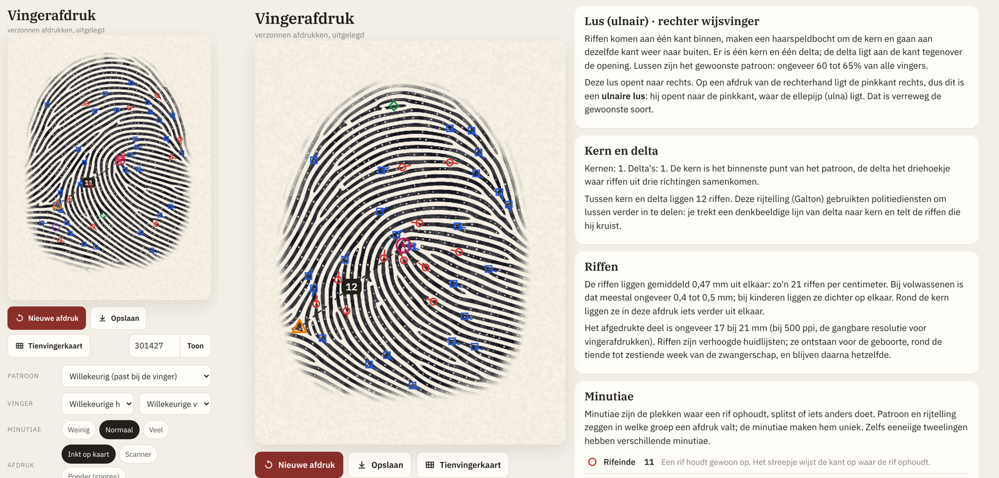

# Vingerafdruk

Maakt willekeurige, verzonnen vingerafdrukken en legt uit wat erin zit. Webpagina en Android-app, volledig offline.



## Wat het doet

- **Plan**: vorm van de vingertop, patroon (boog, tentboog, ulnaire of radiale lus, krul, dubbele lus) met kernen en
  delta's, ridge-richting volgens het zero-pole-model van Sherlock en Monro (bovenin gebogen langs de vingertop) en rifafstand.
  Bij "willekeurig" past het patroon bij de gekozen vinger (lussen het meest, krullen vaak op duimen en ringvingers,
  bogen en radiale lussen vooral op wijsvingers).
- **Groeien**: riffen groeien uit willekeurige stipjes door herhaald filteren met een Gabor-filter dat richting en afstand
  volgt (het idee van SFinGe). Op de GPU met WebGL; zonder WebGL een langzamere CPU-versie.
- **Analyse** zoals een vergelijkingsprogramma: skelet (Zhang-Suen), minutiae via het crossing number, filters voor
  sporen, bruggen en onderbroken riffen, punten, korte riffen en meertjes, rijtelling van kern naar delta (Galton) en zweetporiën.
- **Uitleg** per afdruk: patroon, ulnair/radiaal, kern en delta, rijtelling, rifafstand in mm, tabel met minutiae, poriën.
  Tik op een teken in de afdruk voor uitleg over dat kenmerk.
- **Weergave**: inkt op kaart, scanner of poeder; overlays voor kern en delta, minutiae, rijtelling en ribbelrichting.
- **Tienvingerkaart** met tien afdrukken (rechter- en linkerhand). Opslaan als PNG.
- Met hetzelfde nummer en dezelfde instellingen krijg je dezelfde afdruk.

De afdrukken zijn van niemand; ze zijn bedoeld om te leren hoe vingerafdrukken in elkaar zitten.

## Bouwen

```sh
python3 build.py              # src/ -> index.html en android/assets/index.html
android/build.sh              # APK zonder Gradle
node tools/uitest.js <map>    # Playwright-rondgang
```

Licentie: MIT (code), SIL OFL 1.1 (IBM Plex).
